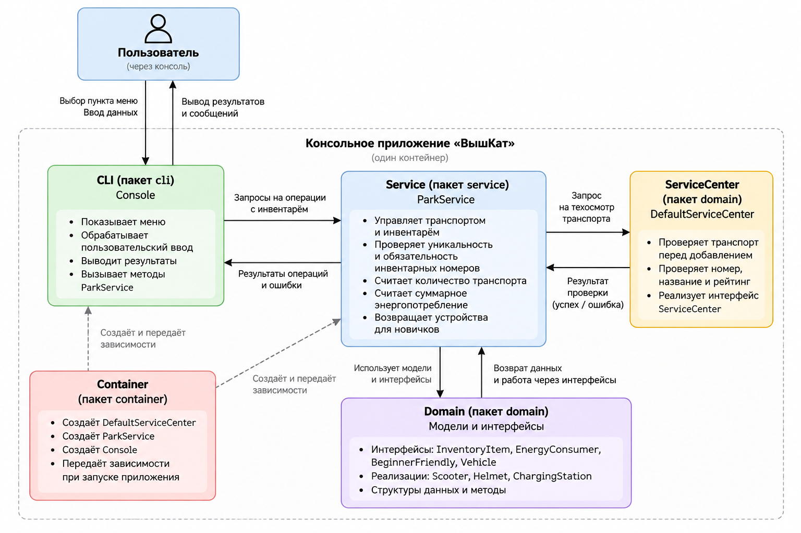

# ВышКат

Консольное приложение на Go для учёта инвентаря парка самокатов.

## 1. Описание проекта

Программа позволяет управлять инвентарём парка: добавлять самокаты, шлемы и зарядные станции, просматривать оборудование и получать информацию о нём.

Реализованы следующие возможности:

- Добавление самокатов после проверки сервисным центром.
- Добавление шлемов и зарядных станций.
- Просмотр всего инвентаря.
- Подсчёт количества транспортных средств.
- Подсчёт общего энергопотребления.
- Получение списка устройств, подходящих для новичков (рейтинг не ниже 6).
- Проверка обязательности и уникальности инвентарных номеров для всего инвентаря, а также корректности характеристик оборудования.

## 2. Запуск программы

Для запуска необходим установленный Go.

Из корневой папки проекта:

```bash
go run .
```

Для запуска тестов:

```bash
go test ./...
```

## 3. Структура проекта

```text
vyshkat/
├── main.go
├── domain/
│   ├── interfaces.go
│   ├── scooter.go
│   ├── helmet.go
│   ├── charging_station.go
│   └── service_center.go
├── service/
│   └── park_service.go
├── cli/
│   └── console.go
├── container/
│   └── container.go
└── README.md
```

Тесты располагаются в соответствующих пакетах в файлах с суффиксом `_test.go`.

- `domain` — модели инвентаря и интерфейсы.
- `service` — бизнес-логика парка.
- `cli` — взаимодействие с пользователем через консоль.
- `container` — создание объектов и передача зависимостей.
- `main.go` — точка входа в программу.

### Диаграмма компонентов (C3)



## 4. Применение SOLID

**SRP — Single Responsibility Principle**

Каждая часть программы отвечает за свою задачу. Например, `Console` обрабатывает пользовательский ввод, а `ParkService` выполняет операции с инвентарём. `DefaultServiceCenter` отвечает за техосмотр транспорта, а `ParkService` обеспечивает обязательность и уникальность инвентарных номеров.

**OCP — Open/Closed Principle**

Для добавления новых типов оборудования можно создавать новые структуры, реализующие интерфейс `InventoryItem`, без изменения основной логики хранения инвентаря. При этом добавление нового пункта интерактивного меню потребует изменения CLI.

**LSP — Liskov Substitution Principle**

Вместо конкретных структур используются интерфейсы. Например, `Scooter` можно использовать там, где ожидается `Vehicle`, поскольку он реализует необходимые методы.

**ISP — Interface Segregation Principle**

Вместо одного большого интерфейса используются небольшие: `InventoryItem`, `EnergyConsumer`, `BeginnerFriendly` и `Vehicle`. Типы реализуют только подходящие им возможности.

**DIP — Dependency Inversion Principle**

`ParkService` зависит от интерфейса `ServiceCenter`, а не от конкретной реализации сервисного центра. Это позволяет передавать разные реализации, в том числе поддельную при тестировании.

## 5. Архитектурные решения

**Какой принцип SOLID применён наиболее явно и где?**

Наиболее явно применяется **DIP (Dependency Inversion Principle)**. В [service/park_service.go](service/park_service.go) `ParkService` зависит от интерфейса `ServiceCenter`, а не от конкретной реализации. Зависимость передаётся через конструктор `NewParkService()`, а её создание организовано в [container/container.go](container/container.go).

Это позволяет подменять сервисный центр, например, при тестировании.

**Какой принцип сознательно ограничен и почему это приемлемо?**

Частично ограничен **OCP (Open/Closed Principle)**. При добавлении нового вида оборудования основную бизнес-логику менять не требуется, но необходимо дополнить меню в [cli/console.go](cli/console.go).

Поскольку это небольшое CLI-приложение, универсальный механизм регистрации новых типов оборудования только усложнил бы проект.


## 6. Расширение программы

Например, при добавлении нового вида транспорта — электровелосипеда `ElectricBike` — потребуется создать новую структуру в пакете `domain`, реализующую интерфейс `Vehicle` и при необходимости `EnergyConsumer`.

При этом **не придётся изменять** `ParkService`: методы добавления транспорта, подсчёта количества и энергопотребления продолжат работать через существующие интерфейсы. Проверка техосмотра также сохранится.

**Изменить потребуется** `cli/console.go`: добавить новый пункт меню и обработку ввода характеристик электровелосипеда.

Таким образом, добавление нового транспорта не сломает существующую бизнес-логику, но потребует расширения консольного интерфейса.

## 7. Dependency Injection

Для создания зависимостей используется пакет `container`.

В `main.go` создаётся сервисный центр, после чего он передаётся в `NewContainer()`. Контейнер создаёт `ParkService` и `Console`.

Благодаря этому создание объектов отделено от их основной логики.

## 8. Тестирование

Для проверки программы написаны unit-тесты.

Тестами проверяются:

- Добавление транспорта и другого инвентаря.
- Работа проверок и ограничений.
- Подсчёт энергопотребления.
- Выбор устройств для новичков.
- Обработка пользовательского ввода.
- Основные сценарии работы консоли.

**Проверка техосмотра и правила для новичков**

В файле [service/park_service_test.go](service/park_service_test.go) реализованы следующие тесты:

- `TestParkServiceRejectsVehicleWithFakeServiceCenter` — проверяет отказ в добавлении транспорта при отрицательном решении техосмотра.
- `TestParkServiceAcceptsVehicleWithFakeServiceCenter` — проверяет добавление транспорта при положительном решении техосмотра.
- `TestParkServiceGetBeginnerDevices` — проверяет отбор устройств с рейтингом для новичков не ниже 6.

Для подмены зависимости используется `FakeServiceCenter`, реализующий интерфейс `ServiceCenter`. Результат техосмотра задаётся полем `accept` (`true` или `false`). При создании `ParkService` поддельный сервисный центр передаётся в `NewParkService()` вместо `DefaultServiceCenter`.

Последнее измеренное общее покрытие тестами — **74,7%**, что превышает требуемые 60%.

Для получения актуального значения используется команда:

```bash
go test -count=1 -coverpkg=./... -coverprofile=coverage.out ./...
go tool cover -func=coverage.out
```

## 9. Пример использования

1. Пользователь запускает приложение.
2. Выбирает добавление транспорта.
3. Вводит инвентарный номер, название, энергопотребление и рейтинг самоката.
4. Программа проверяет данные и добавляет самокат.
5. Пользователь может просмотреть инвентарь, количество транспорта и суммарное энергопотребление.
6. Для завершения работы выбирает пункт `0`.

## 10. Принятые решения и ограничения

Данные хранятся в памяти программы и не сохраняются после завершения работы, поскольку использование базы данных не предусмотрено в рамках проекта.

Консольный интерфейс реализован отдельно от бизнес-логики. Вывод выполняется непосредственно через `fmt`, поэтому тесты CLI в основном проверяют изменение состояния приложения, а не содержимое напечатанного текста.

## 11. Использование ИИ

При разработке использовался ChatGPT для обсуждения архитектуры, помощи с тестированием и анализа ошибок.
Подробное описание использования ИИ и примеры запросов приведены в файле [AI_USAGE.MD](AI_USAGE.MD).

## 12. Тестовый сценарий

Для быстрой проверки программы можно скопировать и выполнить команду из корневой папки проекта:

```bash
go run . <<'EOF'
1
1
SC-001
Suzuki
2.5
8
2
1
HL-001
Helmet
3
4
5
6
0
EOF
```

**Ожидаемый результат:**
- Добавлен один самокат и один шлем.
- Количество транспорта — 1.
- Суммарное энергопотребление — 2.5 кВт·ч.
- Самокат `SC-001` отображается в списке для новичков.
- Оба объекта отображаются в общем инвентаре.